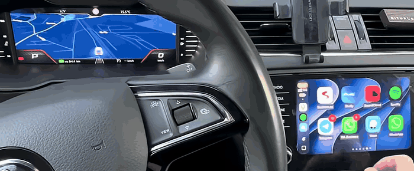

# CarPlay maps on the Virtual Cockpit — MIB2 Standard (MST2)

CarPlay's **instrument-cluster navigation view** on the Virtual Cockpit, while the main
CarPlay screen keeps running on the radio display. Two independent displays, one phone.

A downstream port of **[harman-f/mhi2_altscreen_carplay](https://github.com/harman-f/mhi2_altscreen_carplay)**
to a platform it cannot run on. Not a GitHub fork only because forks are excluded from
search, and this project needs to be findable by people with other units.

*Google Maps and Waze switched on the cluster, CarPlay running on the radio display the
whole time — [full video](https://www.youtube.com/shorts/Reirt4VjI4Y).*

> ### ⚠️ READ FIRST
>
> **Work in progress. Not finished, not a product, not an installer.**
>
> - **Not an SD-card solution.** You need shell access to your own head unit.
> - **Experiments can leave the unit unusable until a reboot**, or take it down entirely.
> - **No warranty. No liability** for damage to head units, clusters, any other vehicle
>   component, or data — and modifying a head unit **will very likely void your
>   manufacturer warranty**.
> - Your own vehicle only, where legal.
>
> If that is not acceptable, stop here.

## Status

`✅ works` · `🟥 blocking` · `⬜ not yet`

| | |
|---|---|
| ✅ Cockpit | CarPlay cluster navigation, decoded natively (1024×384) |
| ✅ Radio display | Normal CarPlay, unaffected |
| ✅ Apps | Apple Maps, Waze, Google Maps — seamless switching |
| 🟥 Route guidance | The cluster covers the picture with "navigation is running on the phone" |
| ⬜ Layout / SafeArea | Picture is composed blind — not calibrated against the cluster's own elements |
| ⬜ Steering-wheel control | The wheel still zooms the stock map, not CarPlay |
| ⬜ Navigation arrows | No native cluster widgets driven from CarPlay metadata |
| ⬜ Cleanup on disconnect | Last frame stays until the cockpit view is switched |
| ⬜ Frame rate | 10 fps measured; raising it untested |

Road-tested on one vehicle:

| | |
|---|---|
| Head unit | MIB2 Standard "MST2", firmware `MST2_EU_SK_ZR_P0480T` (Škoda Amundsen) |
| Cluster | Virtual Cockpit **AID 10", part `5E0920790A`** |

**Other firmware is intended, not supported yet** — we simply have no other unit to test
on. Most of the work is firmware-independent (the CarPlay session, the push protocol, the
window handling), so widening support is a matter of testing rather than redesign. If you
have a MIB2 Standard unit with shell access, see *Help wanted* in
[ROADMAP.md](ROADMAP.md).

👉 **[ROADMAP.md](ROADMAP.md)** — full status, what is missing, what is planned.

## Why this exists

From the factory, MIB2 Standard shows the navigation map in **one place at a time** —
cockpit **or** radio display — and only the built-in Škoda map.

Getting CarPlay maps onto the Virtual Cockpit has been solved elsewhere, but **no public
project covers MST / MIB2 Standard units**. The known work targets **Harman MHI2 ("High")**
and cannot run here: MST2 has **no `/dev/mlb`** at all — MOST sits behind a second chip
(TI Jacinto 5).

The goal is a third-party map on the cluster, past what the unit does from the factory.
**That limit is not hardware:** with both displays running, load is ~3 % of the quad-core,
because decode and encode happen on the VPU.

| | MHI2 (harman-f, omonob) | MIB2 Standard (this) |
|---|---|---|
| Source | CarPlay Type-111 alt screen | same |
| Decoding | none — the cluster decodes | **own mm-renderer context** |
| Path to cluster | MPEG-TS → `/dev/mlb/isoTX2` | render to `dpy-6`, DisplayManager captures |
| Entry point | after the encoder | before it |

The architecture transfers between platforms; the code does not.

## Documentation

| | |
|---|---|
| [ROADMAP.md](ROADMAP.md) | status, gaps, plan |
| [docs/UPSTREAM-STATUS.md](docs/UPSTREAM-STATUS.md) | side by side with upstream, what can be forked |
| [docs/ARCHITECTURE.md](docs/ARCHITECTURE.md) | how the picture reaches the cluster |
| [docs/INSTALL.md](docs/INSTALL.md) | developer install, kill switch, uninstall |
| [docs/PROTOCOL-MDEVPUSH.md](docs/PROTOCOL-MDEVPUSH.md) | the undocumented push protocol |
| [docs/FINDINGS.md](docs/FINDINGS.md) | constraints, dead ends, corrections |

## Licence

GPL-3.0-or-later. Forked from
**[harman-f/mhi2_altscreen_carplay](https://github.com/harman-f/mhi2_altscreen_carplay)** —
see [CREDITS.md](CREDITS.md).

## Legal

**Independent project. Not affiliated with, endorsed by, sponsored by or connected to
Volkswagen AG, Škoda Auto a.s., Apple Inc., BlackBerry Limited (QNX), TechniSat or Preh,
or any of their subsidiaries.**

Volkswagen, Škoda, Amundsen, MIB and Virtual Cockpit are trademarks of Volkswagen AG
and/or its subsidiaries. Apple, CarPlay and Apple Maps are trademarks of Apple Inc. QNX is
a trademark of BlackBerry Limited. Used here only to identify the hardware and software
this project works with — nominative use, no claim of ownership.

**No vendor firmware, binaries, map data or other proprietary material is distributed
here.** Everything in this repository is either original work, a fork of GPL-3.0 code
(see [CREDITS.md](CREDITS.md)), or a description of observed behaviour. The build links
against two libraries from the head unit, which you fetch from your own vehicle
(`tools/pull-linkstubs.sh`); they are never copied into the output or redistributed.

Interoperability research on a device you own. Check what applies where you live before
using it.
