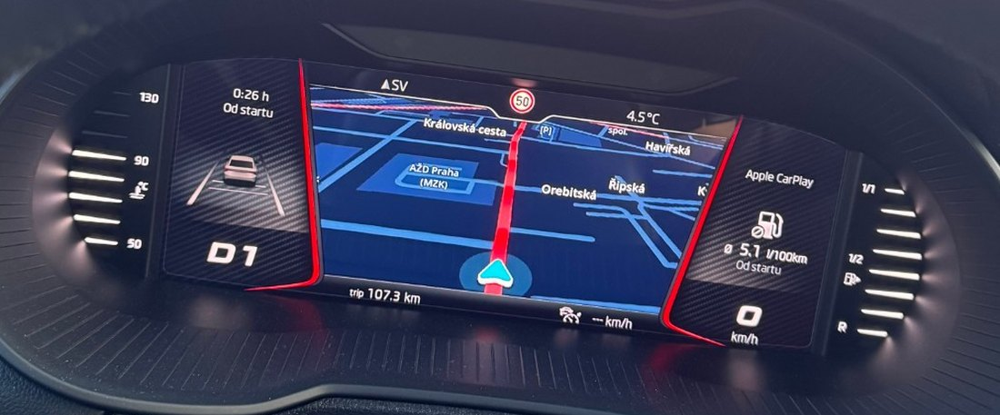

# CarPlay maps on the Virtual Cockpit — MIB2 Standard (MST2)

CarPlay's **instrument-cluster navigation view** on the Virtual Cockpit, while the main
CarPlay screen keeps running on the radio display. Two independent displays, one phone.

   
  <em>CarPlay navigation on the cluster. The radio display is running CarPlay at the same time.</em>

   
  <em>Google Maps and Waze switched on the cluster — <a href="https://www.youtube.com/shorts/Reirt4VjI4Y">full video</a>.</em>

> ### ⚠️ READ FIRST
>
> **Work in progress. Not finished, not a product, not an installer.**
>
> - **TechniSat/Preh units only**, not Delphi.
> - **Not an SD-card solution.** You need shell access to your own head unit.
> - **Experiments can leave the unit unusable until a reboot**, or take it down entirely.
> - **No warranty. No liability** for damage to head units, clusters, any other vehicle
>   component, or data — and modifying a head unit **will very likely void your
>   manufacturer warranty**.
> - Your own vehicle only, where legal.
>
> If that is not acceptable, stop here.

## Status

`✅ works` · `🟡 partly` · `⬜ not yet`

| | |
|---|---|
| ✅ Cockpit | CarPlay cluster navigation, decoded natively (1024×384) |
| ✅ Radio display | Normal CarPlay, unaffected |
| ✅ Apps | Apple Maps, Waze, Google Maps — seamless switching |
| ✅ Route guidance | The cluster's "navigation is running on the phone" overlay is gone — see [docs/HMI-OVERLAY.md](docs/HMI-OVERLAY.md) |
| ✅ Layout | Map-only cluster surface, centred. The manoeuvre card stays on the radio display by choice |
| 🟡 Steering-wheel control | The wheel still zooms the stock map. Where its request arrives is known — see [docs/CLUSTER-ZOOM.md](docs/CLUSTER-ZOOM.md) |
| ⛔ Navigation arrows | The cluster's own widgets cannot be driven: no CarPlay turn-by-turn data reaches the head unit |
| ⬜ Cleanup on disconnect | Last frame stays until the cockpit view is switched |
| ⬜ Frame rate | 10 fps — a constant in the HMI, not a negotiated limit. Raising it untested |

Road-tested on one vehicle:

| | |
|---|---|
| Head unit | Škoda Amundsen 8", part `5Q0035874C` — MIB2 Standard "MST2", firmware `MST2_EU_SK_ZR_P0480T` |
| Cluster | Virtual Cockpit **AID 10", part `5E0920790A`** |

**This is for TechniSat/Preh units, not Delphi.** Both are sold as MIB2 Standard and both
run `MST2_` firmware, so the prefix alone does not identify the unit — the trailing letter
does. **`T` is TechniSat/Preh**, as in `MST2_EU_SK_ZR_P0480T`; **`D` is Delphi**, as in
`MST2_EU_VW_P0876D`.

**Other TechniSat/Preh firmware** is intended but untested — there is no second unit here.
Most of the work is firmware-independent, so it is a matter of testing rather than
redesign. If you have one with shell access, see *Help wanted* in
[ROADMAP.md](ROADMAP.md).

👉 **[ROADMAP.md](ROADMAP.md)** — full status, what is missing, what is planned.

## Why this exists

From the factory, MIB2 Standard shows the navigation map in **one place at a time** —
cockpit **or** radio display — and only the built-in Škoda map.

Getting CarPlay maps onto the Virtual Cockpit has been solved elsewhere, but **only for
Harman MHI2 ("High")**, which cannot run here: MST2 has **no `/dev/mlb`** at all — MOST
sits behind a second chip (TI Jacinto 5).

**No public project puts a third-party CarPlay map on the cluster of these units**, which
is what this is for.

The goal is a third-party map on the cluster, past what the unit does from the factory.
**That limit is not hardware:** with both displays running, load is ~3 % of the quad-core,
because decode and encode happen on the VPU.

| | MHI2 (harman-f, omonob) | MIB2 Standard (this) |
|---|---|---|
| Source | CarPlay Type-111 alt screen | same |
| Decoding | none — the cluster decodes | **own mm-renderer context** |
| Path to cluster | MPEG-TS → `/dev/mlb/isoTX2` | render to `dpy-6`, DisplayManager captures |
| Entry point | after the encoder | before it |

The architecture transfers between platforms; the code does not.

## Documentation

| | |
|---|---|
| [ROADMAP.md](ROADMAP.md) | status, gaps, plan |
| [docs/UPSTREAM-STATUS.md](docs/UPSTREAM-STATUS.md) | side by side with upstream, what can be forked |
| [docs/ARCHITECTURE.md](docs/ARCHITECTURE.md) | how the picture reaches the cluster |
| [docs/INSTALL.md](docs/INSTALL.md) | developer install, kill switch, uninstall |
| [docs/PROTOCOL-MDEVPUSH.md](docs/PROTOCOL-MDEVPUSH.md) | the undocumented push protocol |
| [docs/HMI-OVERLAY.md](docs/HMI-OVERLAY.md) | removing the cluster's "navigation on phone" overlay |
| [docs/CLUSTER-ZOOM.md](docs/CLUSTER-ZOOM.md) | steering-wheel zoom: where the request arrives |
| [docs/FINDINGS.md](docs/FINDINGS.md) | constraints, dead ends, corrections |

## Licence

GPL-3.0-or-later. Forked from
**[harman-f/mhi2_altscreen_carplay](https://github.com/harman-f/mhi2_altscreen_carplay)** —
see [CREDITS.md](CREDITS.md).

## Legal

**Independent project. Not affiliated with, endorsed by, sponsored by or connected to
Volkswagen AG, Škoda Auto a.s., Apple Inc., BlackBerry Limited (QNX), TechniSat or Preh,
or any of their subsidiaries.**

Volkswagen, Škoda, Amundsen, MIB and Virtual Cockpit are trademarks of Volkswagen AG
and/or its subsidiaries. Apple, CarPlay and Apple Maps are trademarks of Apple Inc. QNX is
a trademark of BlackBerry Limited. Used here only to identify the hardware and software
this project works with — nominative use, no claim of ownership.

**No vendor firmware, binaries, map data or other proprietary material is distributed
here.** Everything in this repository is either original work, a fork of GPL-3.0 code
(see [CREDITS.md](CREDITS.md)), or a description of observed behaviour. The build links
against two libraries from the head unit, which you fetch from your own vehicle
(`tools/pull-linkstubs.sh`); they are never copied into the output or redistributed.

Interoperability research on a device you own. Check what applies where you live before
using it.
